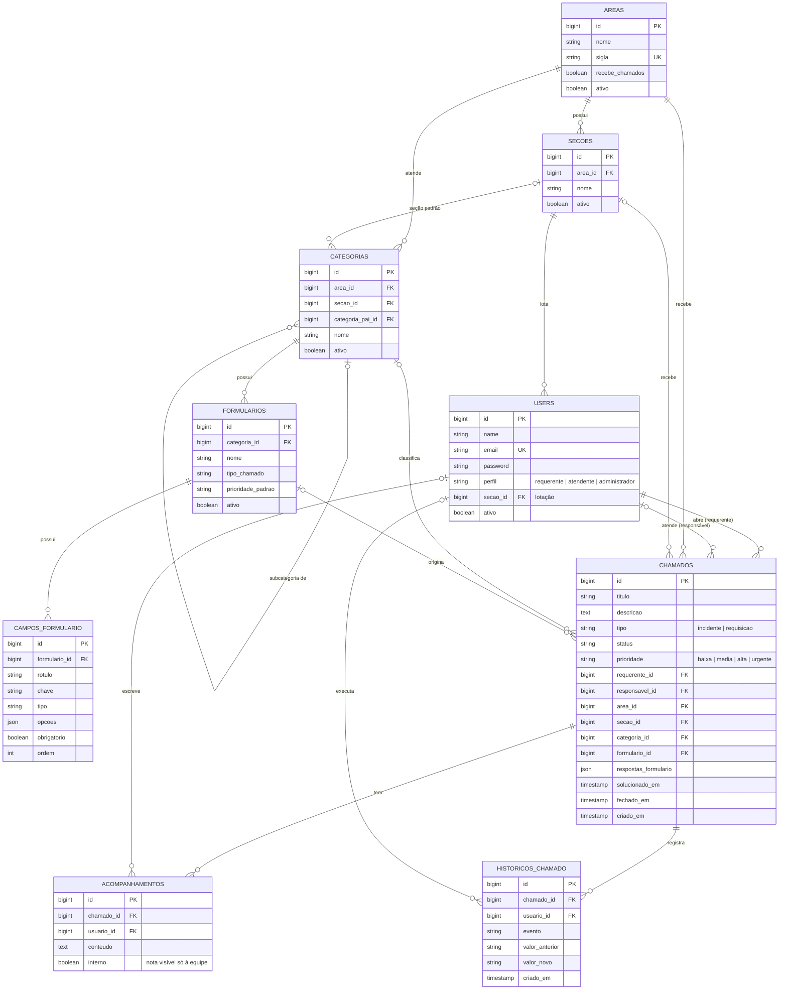
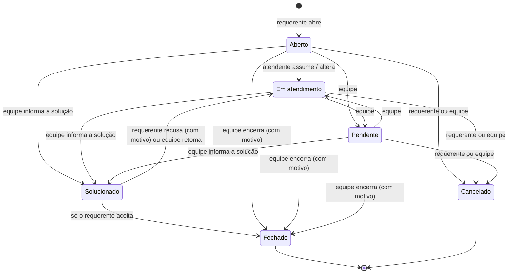
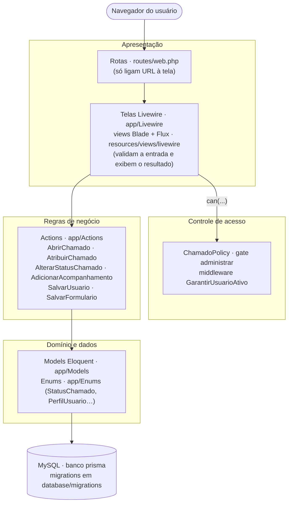

# Prisma · Diagramas (Fichas 14 e 15)

Os diagramas estão em Mermaid: o GitHub os desenha automaticamente ao abrir este arquivo.
Fonte da verdade: `database/migrations`, `app/Enums/StatusChamado.php` e `app/Policies/ChamadoPolicy.php`.

## 1. Modelo de dados (Ficha 14)

**Regras de integridade principais**
- Área, seção, categoria ou formulário em uso não são excluídos, apenas desativados (`motivoParaNaoExcluir()`).
- O chamado guarda uma cópia das respostas do formulário (`respostas_formulario`), preservada mesmo se o formulário mudar.
- O histórico (`historicos_chamado`) só recebe inserções: nunca é editado.

## 2. Máquina de estados do chamado (Ficha 14)

Cada transição grava uma linha em `historicos_chamado`. Atribuir um responsável a um chamado Aberto
o move automaticamente para Em atendimento (`AtribuirChamado`).

## 3. Arquitetura em camadas (Ficha 15)

Dependências apontam sempre para dentro: telas conhecem Actions, Actions conhecem Models, Models conhecem o banco.
Nenhuma regra de negócio fica nas rotas ou nas telas (ADR-002). Decisões detalhadas em `docs/adr/`.
